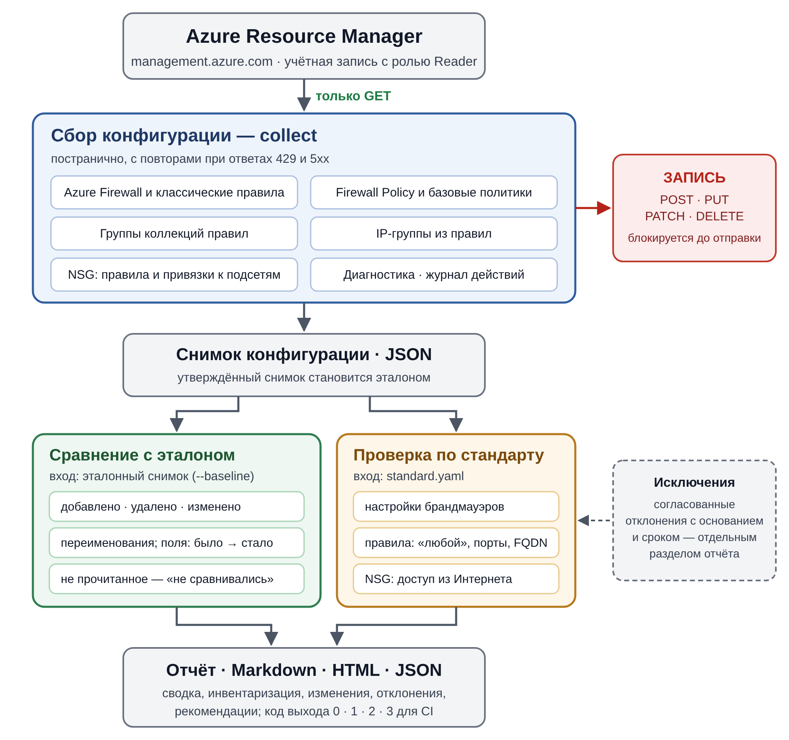
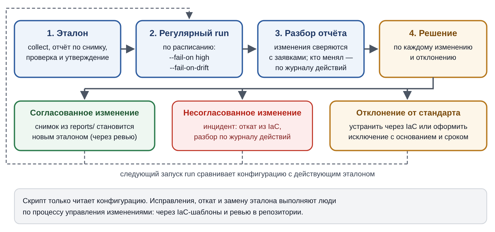

# Аудит конфигурации Azure Firewall и NSG

Описание решения и руководство администратора · версия документа 1.1 · ноябрь 2026 · соответствует azure-firewall-audit 1.1.0

Документ описывает, как устроен инструмент `azfw_audit.py`, как его развернуть, настроить и
эксплуатировать. Требования к инструменту и критерии приёмки приведены в документе
«Требования к инструменту аудита конфигурации Azure Firewall и NSG» (`docs/requirements.md`),
краткая инструкция — в `README.md`.

## 1. Назначение

Инструмент получает конфигурацию Azure Firewall и Network Security Groups, сравнивает её с
утверждённым эталоном, проверяет по стандарту безопасности и формирует отчёт в форматах
Markdown, HTML и JSON. Он работает только на чтение: в Azure отправляются только GET-запросы,
а учётной записи достаточно роли Reader.

Инструмент отвечает на три вопроса:

- **Что изменилось** с момента утверждения эталона и кто вносил изменения.
- **Что не соответствует стандарту**: опасные правила, слабые режимы защиты, отсутствие журналов.
- **Что есть в инфраструктуре**: сводка брандмауэров, политик и NSG с их ключевыми параметрами.

## 2. Общая схема работы



1. **Сбор.** Инструмент получает токен Microsoft Entra ID и запрашивает конфигурацию у Azure
   Resource Manager. HTTP-клиент пропускает только GET-запросы.
2. **Снимок.** Конфигурация сохраняется в JSON-файл вместе с временем сбора, областью сбора и
   ошибками чтения. Утверждённый снимок становится эталоном.
3. **Сравнение.** Текущий снимок сравнивается с эталоном по отдельным объектам — до конкретного
   поля конкретного правила.
4. **Проверка.** Конфигурация проверяется по требованиям `standard.yaml`; согласованные
   отклонения переносятся в раздел исключений.
5. **Отчёт.** Формируется отчёт; код выхода сообщает конвейеру, превышены ли пороги.

Шаги 1–2 выполняет команда `collect`, шаги 3–5 — команда `report`, всё вместе — команда `run`.
Команда `report` работает с сохранёнными снимками и к Azure не обращается.

## 3. Сбор конфигурации

### 3.1. Какие данные запрашиваются

В таблице `{область}` — это `/subscriptions/{подписка}` или, с параметром `-g`,
`/subscriptions/{подписка}/resourceGroups/{группа}`; `{подписка}` — ID подписки.

| Данные | Запрос к Azure Resource Manager | Версия API |
|-----------------------|----------------------------------------------------------------------|-------------|
| Брандмауэры области | `GET {область}/providers/Microsoft.Network/azureFirewalls`; с `-g` и `-f` — `GET …/azureFirewalls/{имя}` | 2024-05-01 |
| Политика брандмауэра и базовые политики | `GET {id политики}` | 2024-05-01 |
| Группы коллекций правил | `GET {id политики}/ruleCollectionGroups` | 2024-05-01 |
| Все политики области (`--all-policies`) | `GET {область}/providers/Microsoft.Network/firewallPolicies` | 2024-05-01 |
| IP-группы из правил | `GET {id IP-группы}` | 2024-05-01 |
| Параметры диагностики | `GET {id брандмауэра}/providers/Microsoft.Insights/diagnosticSettings` | 2021-05-01-preview |
| NSG области | `GET {область}/providers/Microsoft.Network/networkSecurityGroups` | 2024-05-01 |
| Журнал действий | `GET /subscriptions/{подписка}/providers/Microsoft.Insights/eventtypes/management/values` с фильтром по времени и группе ресурсов или поставщику `Microsoft.Network` | 2015-04-01 |
| Подписки (`--all-subscriptions`) | `GET /subscriptions` | 2022-12-01 |

Версию API `Microsoft.Network` можно изменить параметром `--api-version`.

### 3.2. Порядок сбора

1. Для каждой подписки получается список брандмауэров (или указанные брандмауэры).
2. Из каждого брандмауэра берётся ссылка на политику; для каждой политики загружаются её группы
   коллекций правил и ссылка на базовую политику. Цепочка базовых политик проходится до конца,
   в том числе через другие подписки.
3. В правилах и настройках обхода IDPS находятся ссылки на IP-группы, и каждая IP-группа
   загружается.
4. Для каждого брандмауэра загружаются параметры диагностики (если не указан `--no-diagnostics`).
5. Для каждой подписки загружается список NSG с правилами и привязками (если не указан
   `--no-nsg`). Фильтр `--firewall` на NSG не влияет; для них есть отдельный фильтр `--nsg`.
6. Если задана глубина журнала действий, из него выбираются завершённые (Succeeded, Failed)
   операции записи и удаления брандмауэров, политик, IP-групп, NSG, подсетей и параметров
   диагностики брандмауэров, а также развёртывания черновиков политик.

### 3.3. Как обеспечивается режим «только чтение»

- HTTP-сессия создаётся с транспортным адаптером `ReadOnlyAdapter`. Он проверяет метод каждого
  запроса непосредственно перед отправкой и для всего, кроме GET и HEAD, вызывает исключение
  `ReadOnlyViolation`: запрос не покидает процесс, а инструмент завершается с кодом 1.
- Класс `ArmClient` предоставляет только методы `get` и `list`.
- Перед каждым запросом проверяется адрес: токен отправляется только на хост Resource Manager.
- POST-операции Azure, которые лишь читают данные (`listIdpsSignatures`, `learnedIPPrefixes`),
  не используются.
- Учётной записи назначается только роль Reader, поэтому даже при ошибке в коде Azure отклонил
  бы запрос на запись.

### 3.4. Ошибки и повторы

| Ситуация | Поведение |
|--------------------------------------|------------------------------------------------------------------|
| 429, 500, 502, 503, 504 | Повтор, всего до 5 попыток; пауза из заголовка `Retry-After` (не более 60 с) или растущая (2, 4, 8, 16 с) |
| Сетевая ошибка | Повтор с растущей паузой (не более 30 с) |
| 401, 403 и другие ошибки объекта | Ошибка записывается в снимок с признаком неполноты, сбор продолжается; итоговый код выхода — 3 |
| 404 | Объект отсутствует; ошибка записывается, но данные считаются полными (удалённый брандмауэр — это результат, а не пробел) |
| Нет токена Entra ID | Немедленное завершение с кодом 1 без снимка и отчёта |
| Истекает токен | Токен обновляется за 5 минут до истечения |

Ошибка получения списка объектов одного типа (например, NSG) помечается типами объектов, которые
она скрывает, и не мешает сравнивать объекты других типов в той же подписке.

### 3.5. Формат снимка

Снимок — JSON-файл с отсортированными ключами. Объекты хранятся в том виде, в каком их вернул
Azure, поэтому снимок одновременно служит свидетельством для аудита.

| Ключ | Содержимое |
|--------------------------|------------------------------------------------------------------------|
| `schema_version` | Версия схемы снимка (1) |
| `tool` | Имя и версия инструмента |
| `collected_at` | Время сбора, UTC |
| `scope` | Область сбора: `subscriptions`, `resource_group`, `firewalls`, `all_policies`, `nsgs`, `include_nsgs` |
| `arm_endpoint`, `api_versions` | Адрес Resource Manager и версии API |
| `firewalls` | Брандмауэры: ARM ID в нижнем регистре → ресурс |
| `firewall_policies` | Политики: ARM ID → `{resource, rule_collection_groups}` |
| `ip_groups` | IP-группы: ARM ID → ресурс |
| `diagnostic_settings` | Параметры диагностики: ARM ID брандмауэра → список; `null`, если не собирались |
| `network_security_groups` | NSG: ARM ID → ресурс; `null`, если не собирались |
| `activity_log` | `{from, to, events, errors}` или `null` |
| `errors` | Ошибки чтения: `scope`, `stage`, `status`, `message`, `incomplete`, при необходимости `kinds` |

## 4. Выявление изменений

### 4.1. Объекты сравнения

Снимок раскладывается на объекты с устойчивыми ключами. Ключ строится из ARM ID и имён в
нижнем регистре, поэтому сравнение не зависит от порядка объектов и регистра. В отчёте объект
обозначается путём:

| Объект | Путь в отчёте |
|------------------------------|------------------------------------------------------------------|
| Брандмауэр | `группа/брандмауэр` |
| Классическая коллекция и правило | `группа/брандмауэр/classic-network/коллекция/правило` (`classic-application`, `classic-nat`) |
| Политика | `группа/политика` |
| Группа коллекций, коллекция, правило | `группа/политика/группа-коллекций/коллекция/правило` |
| IP-группа | `группа/ip-группа` |
| Параметр диагностики | `группа/брандмауэр/diagnostics/имя` |
| NSG и её правило | `группа/nsg`, `группа/nsg/правило` |

Те же пути используются в разделе отклонений и в шаблонах исключений.

### 4.2. Нормализация

Перед сравнением каждый объект приводится к каноническому виду:

- удаляются служебные поля `etag`, `provisioningState`, `size`, `changeNumber`;
- удаляются обратные ссылки, которые ведёт Azure: брандмауэры и дочерние политики в политике,
  `ipGroups` в брандмауэре, брандмауэры и политики в IP-группе;
- пустые значения (`null`, `""`, `[]`, `{}`) удаляются, чтобы пустое поле и отсутствующее поле
  совпадали;
- списки сортируются, ARM ID приводятся к нижнему регистру;
- в правилах NSG единственные поля (`sourceAddressPrefix`, `destinationPortRange` и т. п.)
  объединяются со списочными (`sourceAddressPrefixes`, `destinationPortRanges`), ссылки на
  группы безопасности приложений заменяются их ID;
- правила NSG по умолчанию исключаются: Azure не позволяет их менять;
- привязки NSG сохраняются как списки ID подсетей, сетевых интерфейсов и журналов потоков; сетевые
  интерфейсы экземпляров масштабируемых наборов исключаются — они меняются при автомасштабировании.

### 4.3. Виды изменений

| Вид | Когда | Что показывается |
|------------------|------------------------------------------------------|----------------------------|
| Добавлено | Объект есть только в текущем снимке | Краткое описание: для правила — протокол, источники, назначения, порты |
| Удалено | Объект есть только в эталоне | То же |
| Переименовано | Удалённое и добавленное правило в одной коллекции или NSG совпадают по содержимому | Старое и новое имя |
| Изменено | Объект есть в обоих снимках, содержимое различается | Каждое изменённое поле: `было → стало`; для списков — добавленные и удалённые элементы |
| Не сравнивался | Объект не удалось прочитать в одном из снимков (кроме 404) | Причина |

Если раздел (NSG или параметры диагностики) не собирался в одном из снимков, он целиком
исключается из сравнения, а в отчёт добавляется пометка, например «NSG не сравнивались: в эталоне
они не собирались». Так эталон версии 1.0.0 продолжает работать после обновления до 1.1.0.

Если области сбора эталона и снимка различаются (подписки, группа ресурсов, фильтры), в отчёте
выводится предупреждение.

### 4.4. Кто внёс изменение

Различие снимков показывает, **что** изменилось. **Кто и когда** — показывает раздел «Журнал
действий Azure»: время, учётная запись, операция, ресурс и статус. Привязку NSG к подсети в Azure
меняет операция над подсетью (`virtualNetworks/subnets/write`), поэтому такие операции тоже
попадают в журнал.

## 5. Проверка по стандарту

### 5.1. Настройки брандмауэров

Для брандмауэра с политикой настройки вычисляются по цепочке «политика → базовая политика → …»:

- **Threat Intelligence** — самый строгий режим в цепочке: дочерняя политика может только
  усилить унаследованный режим. Если режим не задан, используется значение Azure по умолчанию —
  Alert.
- **DNS proxy** — первое заданное значение `dnsSettings.enableProxy`, начиная с политики
  брандмауэра. Для брандмауэра с классическими правилами — свойство
  `Network.DNS.EnableProxy`.
- **IDPS** (только Premium) — первое заданное значение режима в цепочке; если не задано — Off.
- **TLS-инспекция** (только Premium) — наличие сертификата ЦС в любой политике цепочки.

Журналирование считается настроенным, если есть параметр диагностики с адресатом (Log Analytics,
хранилище, Event Hub или партнёрское решение) и хотя бы одним включённым журналом. Если задан
`required_log_categories`, каждая категория должна быть включена отдельно или через группу
`allLogs`.

### 5.2. Правила Azure Firewall

Адрес считается «любым», если он есть в `any_address_tokens` (`*`, `0.0.0.0/0`,
`0.0.0.0-255.255.255.255`, `::/0`), имеет префикс `/0` или задаёт диапазон всего адресного
пространства. Для IP-групп проверяется их содержимое.

Проверяются только разрешающие правила (сетевые Allow, правила приложений Allow и DNAT):

| Ситуация | Результат |
|------------------------------------------------------|------------------------------------------|
| Любой источник и любое назначение | `AZFW-ANY-ANY`: критический при всех портах, высокий при отдельных портах, низкий для правила только ICMP; другие проверки к правилу не применяются |
| Все порты или диапазон шире `max_port_range` | `AZFW-ANY-PORT`, средний |
| Любой источник и порт из `sensitive_ports` | `AZFW-SENSITIVE-PORT`, высокий |
| Протокол `Any` | `AZFW-ANY-PROTO`, низкий |
| DNAT из любого источника на чувствительный порт до или после трансляции | `AZFW-SENSITIVE-PORT`, высокий (публикация 50022 → 22 тоже открывает SSH) |
| DNAT из любого источника на порт вне `public_dnat_allowed_ports` | `AZFW-DNAT-PUBLIC`, средний |
| Правило приложений с `*` / шаблоном вида `*.com` | `AZFW-APP-ANY-FQDN`, высокий / `AZFW-APP-BROAD-FQDN`, средний |
| Одинаковые условия и действие у нескольких правил | `AZFW-DUPLICATE`, низкий |

Запрещающие правила на избыточность не проверяются.

### 5.3. Network Security Groups

Проверяются входящие разрешающие правила NSG, у которых среди источников есть значение из
`nsg_public_sources` (`*`, `0.0.0.0/0`, `::/0`, `Internet`) или «любой адрес». Правила с
протоколами ICMP, ESP и AH не проверяются: у них нет портов.

Из портов правила вычитаются порты, которые уже закрывает запрещающее правило с более высоким
приоритетом (меньшим номером), если у него:

- направление «входящее»;
- протокол `*` или тот же, что у разрешающего правила;
- источник из Интернета;
- любые порты источника;
- назначения, которые покрывают назначения разрешающего правила.

По оставшимся портам выбирается одно отклонение, от наиболее серьёзного:

| Оставшиеся порты | Проверка | Уровень |
|------------------------------------|--------------------------|--------------|
| Все порты | `NSG-INTERNET-ANY-PORT` | критический |
| Есть порт из `sensitive_ports` | `NSG-SENSITIVE-PORT` | высокий |
| Диапазон шире `max_port_range` | `NSG-WIDE-PORT` | средний |
| Порт вне `nsg_public_allowed_ports` | `NSG-PUBLIC-PORT` | средний |

Пример. В NSG есть правила `deny-admin` (приоритет 100, Deny, протокол `*`, источник
`Internet`, порты 22 и 3389) и `allow-web` (приоритет 120, Allow, TCP, источник `Internet`,
порты 22, 443, 3389, 8080). Порты 22 и 3389 закрыты первым правилом, 443 разрешён стандартом,
поэтому в отчёте будет одно отклонение `NSG-PUBLIC-PORT` по порту 8080.

NSG без привязки к подсети и сетевому интерфейсу отмечается как `NSG-UNUSED` (уровень «инфо»):
это может означать, что подсеть осталась без защиты.

### 5.4. Уровни отклонений

| Уровень | Значение | Рекомендуемая реакция |
|----------------|------------------------------------------------------|--------------------------------------|
| Критический | Сеть фактически открыта: «любой → любой», все порты из Интернета | Немедленный разбор и устранение |
| Высокий | Открыт административный или чувствительный порт, разрешён любой FQDN, ресурс в сбойном состоянии | Устранение в приоритетном порядке |
| Средний | Слабые режимы защиты, нет журналов, широкие диапазоны, отличия от стандарта | Плановое устранение или исключение |
| Низкий | Отступления от рекомендаций: классические правила, дубли, протокол Any | По возможности |
| Инфо | Пустые объекты, правила без описания, NSG без привязок | К сведению |

Полный перечень проверок — в приложении А документа требований.

### 5.5. Исключения

Исключение задаётся в разделе `exceptions` стандарта:

```yaml
exceptions:
  - check: NSG-PUBLIC-PORT
    object: "rg-app/nsg-snet-web/allow-https-in"
    reason: "Порт 8443 портала согласован, CHG-1061"
    expires: 2026-12-31
```

`check` и `object` — шаблоны с `*` и `?`, регистр не учитывается. Отклонение, подходящее под
исключение, переносится в раздел «Исключения» отчёта и не учитывается в `--fail-on`. Исключение
без `reason` не применяется; после даты `expires` исключение перестаёт действовать. И то и другое,
а также исключения, не совпавшие ни с одним отклонением, перечисляются в отчёте.

## 6. Отчёт

### 6.1. Разделы

| Раздел | Содержимое |
|------------------------------|------------------------------------------------------------------|
| Шапка | Время формирования, время и область снимка, эталон, файл стандарта, отметка «только чтение» |
| Итог | Вывод одной фразой, число отклонений по уровням, число объектов, изменений, исключений, ошибок |
| Инвентаризация | Брандмауэры (SKU, источник правил, Threat Intel, IDPS, DNS proxy, зоны, IP, число правил, журналы, состояние); политики; NSG (число правил, подсети, интерфейсы, число правил с доступом из Интернета, состояние) |
| Изменения относительно эталона | Таблица изменений, пометки о несравниваемых разделах, объекты, которые не сравнивались |
| Журнал действий Azure | Операции изменения за период |
| Отклонения от стандарта | Таблица отклонений по убыванию уровня и рекомендации по каждой проверке |
| Исключения | Принятые отклонения и проблемы исключений |
| Ошибки получения данных | Что не удалось прочитать и почему |

### 6.2. JSON-отчёт

JSON-отчёт предназначен для SIEM и автоматизации. Основные ключи:

| Ключ | Содержимое |
|----------------------|------------------------------------------------------------------------|
| `summary` | `findings_total`, `findings_by_severity`, `accepted_findings`, `drift` (счётчики), `collection_errors`, `incomplete` |
| `inventory` | `firewalls`, `firewall_policies`, `network_security_groups` |
| `drift` | `added`, `removed`, `modified` (с полями `changes`), `renamed`, `not_compared`, `notes`, `scope_mismatch` |
| `findings` | `id`, `check`, `severity`, `title`, `object`, `details`, `recommendation` |
| `accepted_findings` | Отклонения с полем `exception` (`reason`, `expires`) |
| `activity_log`, `errors` | Как в снимке |

Поле `id` — отпечаток отклонения (первые 16 символов SHA-256 от проверки, объекта и описания).
Он не меняется, пока не меняется само отклонение, и подходит для устранения дублей в SIEM.

## 7. Установка и настройка

### 7.1. Установка

```bash
git clone https://github.com/V1ad-CS/oss_llm_security_gateway.git
cd oss_llm_security_gateway/azure-firewall-audit
python -m venv .venv && . .venv/bin/activate
pip install -r requirements.txt
python azfw_audit.py --help
```

Проверка без доступа к Azure — отчёт по демонстрационным снимкам:

```bash
python azfw_audit.py report -c examples/current.snapshot.json -b examples/baseline.snapshot.json -o demo.html
```

### 7.2. Учётная запись

Инструменту нужна учётная запись с ролью Reader на подписках или группах ресурсов с
брандмауэрами, политиками (включая базовые), IP-группами и NSG. Роль назначает администратор с
правом управлять доступом — один раз, вне инструмента:

```bash
az role assignment create --assignee <appId или principalId> --role Reader \
    --scope /subscriptions/<subscription-id>
```

Рекомендуемые способы входа:

| Где запускается | Способ входа | Что настроить |
|--------------------------|------------------------------|------------------------------------------------|
| Виртуальная машина, Azure Automation, контейнер в Azure | Управляемое удостоверение | Включить удостоверение и назначить ему Reader |
| GitHub Actions, Azure DevOps | Workload identity (OIDC) | Федеративные учётные данные приложения, шаг `azure/login` |
| Сервер вне Azure | Сервисный принципал с сертификатом | `AZURE_TENANT_ID`, `AZURE_CLIENT_ID`, `AZURE_CLIENT_CERTIFICATE_PATH` |
| Рабочее место администратора | `az login` | Войти в Azure CLI |

`DefaultAzureCredential` перебирает эти способы автоматически. Секреты сервисного принципала
(`AZURE_CLIENT_SECRET`) лучше не использовать для регулярного запуска.

### 7.3. Стандарт

Скопируйте `standard.yaml` и настройте его под требования организации. Основные параметры:

| Параметр | По умолчанию | Назначение |
|-------------------------------|-------------------------|------------------------------------------|
| `minimum_sku_tier` | `"Standard"` | Минимальный уровень SKU брандмауэра |
| `threat_intel_mode` | `"Deny"` | Требуемый режим Threat Intelligence |
| `idps_mode` | `"Deny"` | Требуемый режим IDPS (Premium) |
| `require_tls_inspection` | `false` | Требовать TLS-инспекцию (Premium) |
| `require_dns_proxy` | `false` | Требовать DNS proxy всегда |
| `require_diagnostic_settings` | `true` | Требовать отправку журналов брандмауэра |
| `required_log_categories` | `[]` | Обязательные категории журналов |
| `require_availability_zones` | `false` | Требовать зоны доступности |
| `require_rule_description` | `false` | Требовать описание правил |
| `max_port_range` | `1000` | Предельная ширина диапазона портов |
| `sensitive_ports` | 20, 21, 22, 23, 135, 137–139, 445, 1433, 1521, 2375, 2376, 3306, 3389, 5432, 5900, 5985, 5986, 6379, 9200, 11211, 27017 | Порты, которые нельзя открывать для любого источника |
| `public_dnat_allowed_ports` | `[80, 443]` | Порты, разрешённые для публикации через DNAT |
| `any_address_tokens` | `*`, `0.0.0.0/0`, `0.0.0.0-255.255.255.255`, `::/0` | Обозначения «любого адреса» |
| `nsg_public_sources` | `*`, `0.0.0.0/0`, `::/0`, `Internet` | Источники, означающие доступ из Интернета в NSG |
| `nsg_public_allowed_ports` | `[80, 443]` | Порты, которые NSG может открывать для Интернета |
| `require_nsg_association` | `true` | Отмечать NSG без привязок |
| `expected_properties` | пусто | Ожидаемые значения свойств: разделы `firewall`, `firewall_policy`, `network_security_group` |
| `exceptions` | пусто | Согласованные исключения |

Значения режимов пишите в кавычках: YAML читает `Off` без кавычек как `false`. Неизвестные
параметры пропускаются с предупреждением, неверные значения останавливают запуск.

## 8. Эксплуатация

### 8.1. Работа с эталоном



1. **Эталон.** Соберите снимок, проверьте отчёт по нему и устраните или оформите исключениями
   найденные отклонения. Сохраните снимок в репозиторий с обязательным ревью:

   ```bash
   python azfw_audit.py collect -s <subscription-id> -o baselines/azfw-baseline.json
   python azfw_audit.py report -c baselines/azfw-baseline.json -o baselines/azfw-baseline.html
   ```

2. **Регулярный запуск** — по расписанию:

   ```bash
   python azfw_audit.py run -s <subscription-id> \
       --baseline baselines/azfw-baseline.json \
       --output-dir reports --fail-on high --fail-on-drift
   ```

3. **Разбор отчёта.** Каждое изменение сверяется с заявками на изменение; автора и время
   показывает журнал действий.
4. **Решение.** Согласованное изменение — снимок из `reports/` заменяет эталон через ревью.
   Несогласованное — инцидент: откат из IaC и разбор. Отклонение — устранение через IaC или
   исключение с основанием и сроком.

После обновления инструмента до 1.1.0 пересоберите эталон, чтобы он включал NSG. До этого NSG
не сравниваются, а отчёт об этом предупреждает.

### 8.2. Запуск по расписанию

Пример задания cron на сервере с управляемым удостоверением:

```cron
17 5 * * * cd /opt/azfw-audit && AZURE_SUBSCRIPTION_ID=<id> .venv/bin/python azfw_audit.py run --baseline baselines/azfw-baseline.json --output-dir /var/lib/azfw-audit/reports --fail-on high --fail-on-drift >> /var/log/azfw-audit.log 2>&1
```

Пример для GitHub Actions с OIDC-входом приведён в `README.md`. Код выхода 2 или 3 должен
приводить к уведомлению ответственных.

| Код | Что делать |
|------|--------------------------------------------------------------------------------------|
| 0 | Пороги не превышены; отчёт сохраняется для истории |
| 1 | Инструмент не отработал: проверить вход в Azure, параметры, файл стандарта или снимка |
| 2 | Есть изменения или отклонения выше порога: разобрать отчёт |
| 3 | Часть конфигурации не прочитана: проверить права, затем разобрать отчёт — он неполный |

### 8.3. Хранение результатов

- Снимки и отчёты содержат адреса и топологию сети: храните их с ограниченным доступом.
  Каталог `reports/` исключён из git.
- Срок хранения отчётов определяется требованиями аудита; снимки старше эталона нужны только для
  расследований.
- JSON-отчёты можно передавать в SIEM; поле `id` отклонения позволяет отслеживать одно и то же
  отклонение между запусками.

### 8.4. Обновление инструмента

1. Получите новую версию из репозитория и установите зависимости из `requirements.txt`.
2. Выполните автотесты: `pip install -r requirements-dev.txt && python -m pytest`.
3. Сформируйте отчёт по текущему эталону командой `report` и убедитесь, что результат ожидаемый.
4. Если в новой версии собираются новые данные, пересоберите эталон.

## 9. Справочник

### 9.1. Команды

| Команда | Назначение |
|----------------------------------------------|------------------------------------------------------|
| `collect -o FILE` | Собрать снимок конфигурации |
| `report -c FILE [-b FILE] [-o FILE \| --output-dir DIR]` | Отчёт по снимкам без обращения к Azure; без `-o` — Markdown в stdout |
| `run --output-dir DIR` | Собрать снимок и сформировать отчёты |

### 9.2. Параметры сбора (`collect`, `run`)

| Параметр | Назначение |
|------------------------------|--------------------------------------------------------------------|
| `-s`, `--subscription ID` | Подписка; можно несколько раз. По умолчанию — `AZURE_SUBSCRIPTION_ID` |
| `--all-subscriptions` | Все включённые подписки, доступные учётной записи |
| `-g`, `--resource-group` | Только эта группа ресурсов |
| `-f`, `--firewall` | Только брандмауэры с этими именами |
| `--all-policies` | Также политики, не привязанные к найденным брандмауэрам |
| `--nsg` | Только NSG с этими именами |
| `--no-nsg` | Не читать NSG |
| `--no-diagnostics` | Не читать параметры диагностики |
| `--activity-days N` | Глубина журнала действий в днях; `0` — не читать. В `run` по умолчанию — с даты эталона, не более 90 |
| `--arm-endpoint URL` | Адрес Resource Manager (по умолчанию `https://management.azure.com`) |
| `--api-version` | Версия API `Microsoft.Network` (по умолчанию 2024-05-01) |
| `--timeout` | Тайм-аут запроса в секундах (по умолчанию 60) |
| `-v`, `--verbose` | Подробный журнал |

### 9.3. Параметры отчёта (`report`, `run`)

| Параметр | Назначение |
|------------------------------|--------------------------------------------------------------------|
| `-c`, `--current FILE` | Текущий снимок (только `report`) |
| `-b`, `--baseline FILE` | Эталонный снимок |
| `--standard FILE` | Стандарт; по умолчанию `standard.yaml` рядом со скриптом |
| `--format` | `md`, `html`, `json` или список через запятую; по умолчанию `md` в `report` и все три в `run` |
| `-o`, `--output FILE` | Файл отчёта; формат по расширению (только `report`) |
| `--output-dir DIR` | Каталог для отчётов (в `run` — также для снимка) |
| `--fail-on LEVEL` | Код 2 при отклонениях этого уровня и выше: `info`, `low`, `medium`, `high`, `critical` |
| `--fail-on-drift` | Код 2 при любых изменениях относительно эталона |

### 9.4. Переменные окружения

| Переменная | Назначение |
|----------------------------------|------------------------------------------------------------|
| `AZURE_SUBSCRIPTION_ID` | Подписка по умолчанию |
| `AZURE_ARM_ENDPOINT` | Адрес Resource Manager по умолчанию |
| `AZURE_TENANT_ID`, `AZURE_CLIENT_ID` | Клиент Entra ID и приложение для входа сервисного принципала или workload identity |
| `AZURE_CLIENT_CERTIFICATE_PATH`, `AZURE_CLIENT_SECRET` | Учётные данные сервисного принципала |
| `AZURE_FEDERATED_TOKEN_FILE` | Токен workload identity |
| `AZURE_AUTHORITY_HOST` | Адрес входа для национальных облаков |
| `HTTPS_PROXY`, `NO_PROXY` | Прокси-сервер |

## 10. Диагностика неполадок

| Симптом | Причина | Решение |
|------------------------------------|------------------------------------|------------------------------------------|
| Код 1, «не удалось получить токен Azure AD» | Ни один способ входа не настроен | Выполнить `az login`, задать переменные сервисного принципала или включить управляемое удостоверение |
| Код 1, «укажите --subscription» | Подписка не задана | Указать `-s`, `AZURE_SUBSCRIPTION_ID` или `--all-subscriptions` |
| Код 3, в ошибках `403 AuthorizationFailed` | Нет роли Reader на часть ресурсов (часто — на подписку с базовой политикой) | Назначить Reader и повторить запуск |
| В отчёте «Брандмауэры не найдены» | Неверная подписка, группа ресурсов или имя | Проверить параметры `-s`, `-g`, `-f` |
| «NSG не сравнивались: в эталоне они не собирались» | Эталон создан версией 1.0.0 или с `--no-nsg` | Пересобрать эталон командой `collect` |
| Предупреждение о различии области сбора | Эталон и снимок собраны с разными параметрами | Собирать оба с одинаковыми `-s`, `-g`, `-f`, `--nsg`, `--all-policies` |
| Много изменений сразу после смены `--api-version` | Новая версия API возвращает новые поля | Пересобрать эталон с той же версией API |
| Медленный сбор, в журнале повторы 429 | Ограничение частоты запросов Azure | Запускать реже, сузить область (`-g`), не запускать параллельно несколько экземпляров |
| Ошибка «… заблокирован: аудит работает только на чтение» | Попытка отправить запрос, отличный от GET (ошибка в доработке кода) | Сообщить разработчику; конфигурация при этом не изменена |

## 11. Ограничения

- Затенение правил Azure Firewall коллекциями с более высоким приоритетом не анализируется,
  выявляются только точные дубли.
- Сервисные теги и FQDN-теги Azure Firewall не раскрываются.
- Для NSG не вычисляются эффективные правила сочетания «NSG подсети + NSG сетевого интерфейса»,
  состав групп безопасности приложений не раскрывается.
- Виртуальные сети не читаются, поэтому подсети без NSG не выявляются; журналы потоков не
  проверяются.
- Черновики политик и маршрутизация Virtual WAN не читаются.
- Журнал действий Azure хранит события 90 дней.

## 12. Сведения для разработчика

### 12.1. Состав каталога

| Путь | Назначение |
|----------------------------------|------------------------------------------------------------|
| `azfw_audit.py` | Инструмент целиком |
| `standard.yaml` | Стандарт по умолчанию с комментариями |
| `requirements.txt`, `requirements-dev.txt` | Зависимости для работы и для тестов |
| `tests/test_azfw_audit.py` | Автотесты; ответы Azure подменяет заглушка с единственным методом `get` |
| `examples/` | Демонстрационные снимки эталона и текущей конфигурации, пример отчёта |
| `docs/` | Требования, это описание, схемы; `build_docx.py` собирает версии в формате Word |

### 12.2. Устройство кода

Разделы `azfw_audit.py` идут в порядке обработки данных:

1. **Azure Resource Manager client** — `ReadOnlyAdapter`, `ArmClient`: запросы, повторы,
   постраничная выдача, токен.
2. **Collection** — `Collector`: обход брандмауэров, политик, IP-групп, диагностики, NSG и журнала
   действий; формирование снимка.
3. **Snapshot model and drift** — `build_entities` раскладывает снимок на объекты,
   `diff_snapshots` сравнивает два снимка.
4. **Standard and deviation checks** — `load_standard`, `Auditor` (проверки), `apply_exceptions`.
5. **Report** — `build_report` собирает данные отчёта, `report_blocks` описывает его разделы,
   `render_markdown`, `render_html`, `render_json` выводят их в нужном формате.
6. **Command line** — разбор параметров, команды `collect`, `report`, `run`, коды выхода.

### 12.3. Как добавить проверку

1. Добавить запись в словарь `CHECKS`: идентификатор, название, рекомендация.
2. В классе `Auditor` вызвать `self._add(проверка, уровень, объект, описание)` в нужном методе
   (`_check_firewall`, `_check_policy`, `_check_rule`, `_check_nsg`).
3. Если нужна настройка — добавить параметр в `DEFAULT_STANDARD`, его проверку в
   `load_standard` и описание в `standard.yaml`.
4. Добавить тест и строку в каталог проверок (приложение А требований) и в `README.md`.

### 12.4. Как добавить новый тип данных

1. Получить данные в `Collector.collect` только через `ArmClient.get` или `ArmClient.list`.
2. Добавить ключ в снимок; если сбор можно отключить, хранить `null` при отключении и добавить
   раздел в `OPTIONAL_SECTIONS`.
3. Разложить данные на объекты в `build_entities` и указать их типы в `KIND_TITLES`.
4. При ошибке получения списка передавать типы объектов в `Collector._error(..., kinds)`.

### 12.5. Документация

Источник документов — файлы Markdown в `docs/`. Версии в формате Word (`docs/*.ru.docx` в корне
репозитория) собираются командой `python docs/build_docx.py`; нужен pandoc 3.x. Схемы хранятся в
SVG и выгружаются в PNG для документов.
